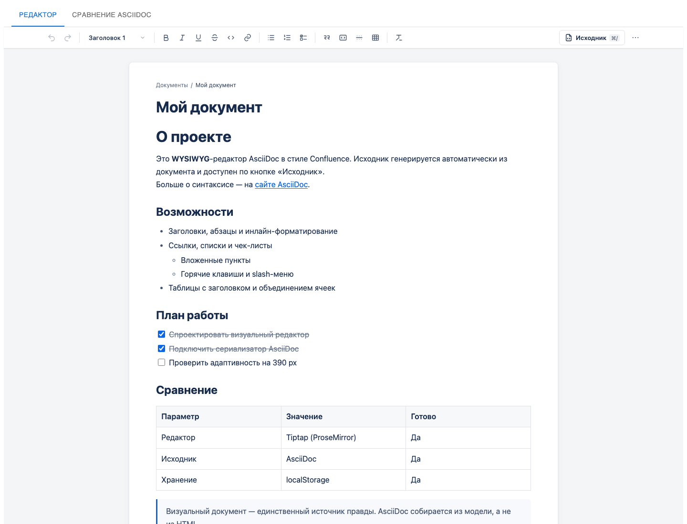
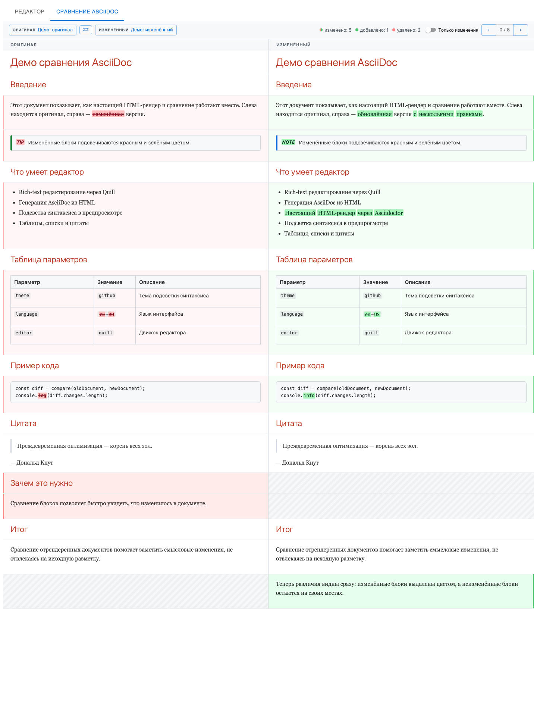

# AsciiDoc WYSIWIG editor + diff





## Kroki (PlantUML)

Self-hosted [Kroki](https://kroki.io/) запускается в том же compose-стеке, что
и приложение. В production Kroki **не публикует порт наружу**: SPA обращается
к нему по same-origin пути `/kroki/`, который проксирует nginx. PlantUML
входит в gateway-образ `yuzutech/kroki`, отдельный `kroki-plantuml` не нужен.

### Запуск

```bash
cp .env.example .env   # опционально: значения совпадают с дефолтами
docker compose up -d --build
docker compose ps
```

`web` ждёт healthcheck Kroki (`depends_on: condition: service_healthy`), поэтому
первый старт JVM-сервиса может занять до минуты. Порт `8000` доступен только
внутри compose-сети; наружу опубликован только `web` (`8080` по умолчанию).

Проверка после запуска:

```bash
curl -fsS http://localhost:8080/kroki/health
curl -fsS http://localhost:8080/kroki/ | head

printf '@startuml\nAlice -> Bob: test\n@enduml\n' > /tmp/test.puml
curl -fsS -X POST -H 'Content-Type: text/plain' \
  --data-binary @/tmp/test.puml \
  http://localhost:8080/kroki/plantuml/svg -o /tmp/test.svg
head -c 80 /tmp/test.svg   # ожидается <svg ...>
```

### Кнопка в приложении

В статусбаре редактора есть ссылка **Kroki** (иконка + точка доступности):
она открывает services page `/kroki/` в новой вкладке. Цвет точки — результат
неблокирующей проверки `/kroki/health` (`checking` / `ok` / `error`); при
недоступном сервисе ссылка остаётся рабочей и не ломает редактор.

Endpoint задаётся при сборке через `VITE_KROKI_URL` (по умолчанию `/kroki`).
Если переменная пуста, кнопка не рендерится. Для переопределения без пересборки
предусмотрен ключ `localStorage` `asciidoc.kroki.url.v1` (пригодится будущему
диалогу настроек диаграмм).

### PlantUML-файлы и вставка в AsciiDoc

Файлы `.puml` и `.plantuml` видны в дереве рядом с документами. Их можно
открыть в редакторе, править (черновик хранится в браузере) и сразу видеть
результат: правая панель рендерит диаграмму через Kroki. Визуального режима и
кнопки сравнения у PlantUML-файлов нет — это исходники диаграмм, а не
документы. Если у `.puml` есть локальный черновик, созданный из текущей версии
на диске, он же используется при вставке в AsciiDoc.

В AsciiDoc диаграмма вставляется макросом:

```asciidoc
== Сценарий

plantuml::diagrams/checkout.puml[format=svg, title="Оформление заказа"]
```

- путь разрешается относительно каталога `.adoc`-файла, а не корня папки;
- поддерживаются `format=svg` (по умолчанию) и `format=png`,
  подпись `title`, альтернативный текст `alt`;
- тот же макрос работает в сравнении: изменение `.puml` считается
  изменением блока, даже если строка макроса не менялась;
- ошибка одного файла (нет доступа, пустой файл, ошибка PlantUML, таймаут)
  показывается в блоке и в предупреждениях, остальной документ рендерится;
- лимит исходника — 256 КБ, путь не может выходить за выбранную папку;
- PlantUML `!include`/`!includeurl` запрещены `KROKI_SAFE_MODE=SECURE`.

Для рендера нужен запущенный Kroki (`docker compose up -d` или dev-вариант
ниже) и `VITE_KROKI_URL`; без endpoint диаграмма показывается с понятной
подсказкой, но редактор продолжает работать.

### Разработка без Docker-сборки приложения

```bash
docker compose -f docker-compose.dev.yml up -d kroki
npm run dev
```

`docker-compose.dev.yml` публикует Kroki только на loopback
(`127.0.0.1:${KROKI_HOST_PORT:-8000}`), а Vite проксирует `/kroki` туда же, как
nginx в production. Значение `VITE_KROKI_URL=/kroki` уже задано в
`.env.development`; при необходимости переопределите его в `.env.local`.

### Переменные

| Переменная | Где | По умолчанию | Назначение |
|---|---|---|---|
| `KROKI_PUBLIC_URL` | compose → build arg | `/kroki` | путь, по которому SPA видит Kroki |
| `VITE_KROKI_URL` | Dockerfile / `.env.development` | `/kroki` | build-time endpoint в бандле |
| `KROKI_IMAGE` | compose | `yuzutech/kroki:0.36.0@sha256:de0f…` | зафиксированный образ |
| `KROKI_MEMORY_LIMIT` | compose | `1g` | лимит памяти JVM/PlantUML |
| `KROKI_HOST_PORT` | `docker-compose.dev.yml` | `8000` | loopback-порт для Vite proxy |
| `HOST_BIND` / `HOST_PORT` | compose | `0.0.0.0` / `8080` | публикация `web` |

### Безопасность и ограничения

- `KROKI_SAFE_MODE=SECURE`; PlantUML `!include`/`!includeurl` запрещены
  (`KROKI_PLANTUML_ALLOW_INCLUDE=false`).
- nginx разрешает только `GET/POST/HEAD/OPTIONS` на `/kroki/` и ограничивает
  тело запроса 2 МБ; клиентские таймауты — 15–20 с, nginx — 30 с, Kroki — 15–20 с.
- Обновление образа — осознанное действие: измените `KROKI_IMAGE` (тег + digest)
  и повторите smoke-тест PlantUML.
- Kroki stateless и не хранит диаграммы.
